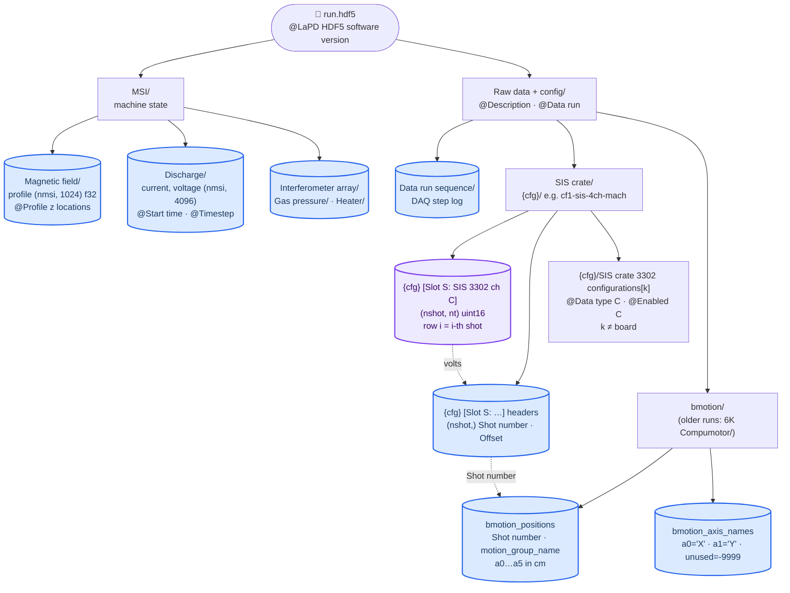
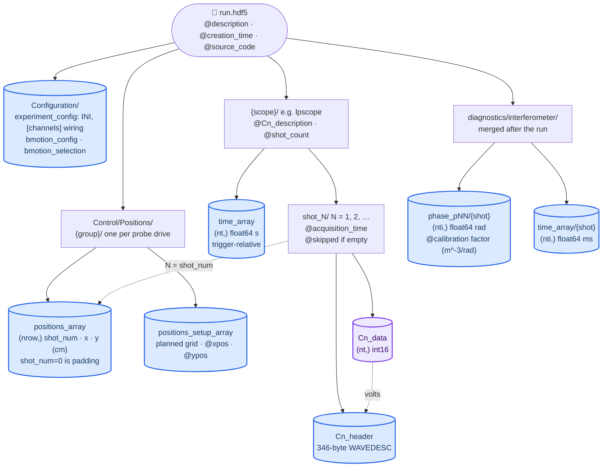

# data-analysis

Shared data-analysis repository for plasma-physics experiments. Created Feb 2024
to consolidate the analysis routines that used to live in separate
`Bdot_analysis`, `LP_analysis`, and `hairpin_analysis` repos, so that one generic
implementation is shared across experiments instead of being copy-pasted per
campaign.

The reusable code is an installable package (`data_analysis`) under `src/`,
organized by **what the code does** — generic DSP, plasma formulas, I/O — not by
which experiment produced it. Each measurement campaign keeps its own thin
scripts/notebooks under `experiments/`, which import only from `data_analysis`.

## Diagnostics covered

- **Langmuir probe (LP)** — plasma parameters from I–V sweeps (`data_analysis.plasma.langmuir`).
- **Mach probe** — area-ratio calibration and flow velocity (`data_analysis.plasma.mach`), with
  diagnostic-agnostic in-plane flow geometry in `data_analysis.plasma.flow`.
- **Bdot** — probe calibration and time integration to B (`data_analysis.plasma.bdot`);
  magnetic-fluctuation processing and STFT spectrograms (`data_analysis.signal`); gridded
  field maths — J = ∇×B/μ₀, Poynting, J·E, Faraday E_φ, vector potential, AC conductivity
  (`data_analysis.plasma.fields`).
- **Interferometer** — line-averaged density traces merged into pydaq dataruns
  (`data_analysis.io.interferometer`); used to absolutely calibrate probe `n_e`.
- **X-ray / photon counting** — pulse detection for bremsstrahlung diagnostics (`data_analysis.plasma.photons`).
- **Thomson scattering / CTS** — Sheffield spectral analysis (`data_analysis.plasma.cts`, `sheffield_thomson`).
- **High-speed-camera tracking** — falling-ball trajectory fitting (`data_analysis.tracking`).

## Package layout

The reusable analysis code lives in an installable package under `src/`,
imported as `data_analysis`. Install it in editable mode from the repo root:

```bash
pip install -e .
```

Modules are grouped by **what they do**, not by which experiment produced them:

| Package | Contents |
|---------|----------|
| `data_analysis.io` | File readers, grouped by data shape — the unified LAPD HDF5 reader (`open_lapd`), interferometer traces, probe↔channel mapping, oscilloscope traces, `.cine` movies, network-analyzer CSV, and the output-path resolver. The *only* place a file format is parsed. See [src/data_analysis/io/README.md](src/data_analysis/io/README.md). |
| `data_analysis.signal` | Generic digital signal processing — filters, STFT, envelopes, cross-spectra, zero-crossing detection, and downsampling helpers. |
| `data_analysis.plasma` | Plasma-physics analysis — Langmuir probes (`langmuir`), Mach probes (`mach`), in-plane flow geometry (`flow`), B-dot calibration/integration (`bdot`), gridded E/B/J field operators (`fields`), photon/X-ray pulse detection (`photons`), CTS / Sheffield Thomson scattering, and `formulas`. |
| `data_analysis.tracking` | High-speed-camera object tracking and trajectory fitting. |
| `data_analysis.viz` | Plotting helpers — shared plot utilities, flow-field maps, and the standalone HTML slider renderer. |
| `data_analysis.utils` | Cross-cutting utilities (a single module, not a subpackage) — file discovery and `.npy` I/O. |

### Optional extras

Some subsystems pull in heavier dependencies, declared as extras in
`pyproject.toml`:

- `pip install -e .[tracking]` — `opencv-python-headless` for `data_analysis.tracking`
  and `data_analysis.io.cine` (both import `cv2` at module load).
- `pip install -e .[scope]` — the sibling [`LAPD_DAQ`](https://github.com/hjia94/LAPD_DAQ)
  package (`scope_io`, …) used by the oscilloscope / pydaq readers. A local
  editable clone at `../LAPD_DAQ` is discovered automatically (see
  [src/data_analysis/io/README.md](src/data_analysis/io/README.md)).
- `pip install -e .[gui]` — `screeninfo`, only for the multi-monitor figure-placement
  helpers in `data_analysis.viz.plot_utils`. Plain plotting works without it.

## LAPD HDF5 data files

LAPD runs arrive in one of two HDF5 layouts. Each layout comes from a different
acquisition system. Every path, shape and dtype below was checked against a real
file of each kind:

- **bapsflib:** Mar-2026 `01-mach-p29-xline-bias.hdf5`
- **pydaq:** Jun-2026 `00-He-800G-bias40V-LP-p29-line_2026-06-10.hdf5`

Use those two files to try the examples. `{braces}` mark names that change from
run to run.

| | Layout 1: **bapsflib** | Layout 2: **pydaq** |
|---|---|---|
| Written by | BaPSF LabVIEW DAQ + C translator | Python [`LAPD_DAQ`](https://github.com/hjia94/LAPD_DAQ) |
| How to recognise it | top-level `Raw data + config/` | top-level scope groups holding `shot_*`, and/or `Control/Positions/` |
| Digitizer | SIS 3302 crate (16-bit) | LeCroy scopes, one group per scope |
| Channel is addressed by | `(board, chan)`, e.g. `(1, 1)` | scope group + `'C1'`…`'C8'` |
| Shots are stored as | one 2-D dataset per channel, one row per shot | one group per shot, one 1-D dataset per channel |
| Raw sample dtype | `uint16` | `int16` |
| Time axis | not stored: `arange(nt) * dt`, starting at 0 | stored `time_array` in seconds, relative to the trigger |
| Probe positions (cm) | `Raw data + config/bmotion/` | `Control/Positions/{motion group}/` |
| Operator's run notes | `Description` attr on `Raw data + config` | `description` attr on the root |
| Machine state (B field, discharge, gas) | `MSI/` | none |
| Interferometer | `MSI/Interferometer array/` | `diagnostics/interferometer/`, added after the run |

There is also a third, older layout: the 2018–2020 process-plasma files
(`Acquisition/LeCroy_scope`). [`detect_backend()`](src/data_analysis/io/lapd_hdf5.py)
recognises all three.

The waveform data is the purple node in each tree. A dotted edge means a
companion dataset you need alongside it: its volts scaling, or the probe position
for that shot.

<table>
<tr>
<th width="50%">Layout 1: bapsflib</th>
<th width="50%">Layout 2: pydaq</th>
</tr>
<tr>
<td valign="top">



</td>
<td valign="top">



</td>
</tr>
</table>

```python
from data_analysis.io import open_lapd

run = open_lapd(path)          # picks the layout; holds no file handle
run.backend                    # 'bapsflib' | 'pydaq'
run.channel_descriptions()     # wiring text, keyed exactly as channel() wants the name
stack, tarr = run.channel(name, shots=...)   # volts, (nshot, nt); same return on both layouts
```

### Layout 1: bapsflib (LabVIEW DAQ)

| You want | Path | Shape / dtype |
|---|---|---|
| Waveform for board B, channel C | `Raw data + config/SIS crate/{config} [Slot S: SIS 3302 ch C]` | `(nshot, nt)` uint16; row i is the i-th recorded shot |
| Volts scaling and shot number for each row | the same name with ` headers` appended | `(nshot,)`, fields `Shot number, Scale, Offset, Min, Max, Clipped` |
| What each channel is wired to | `SIS crate/{config}/SIS crate 3302 configurations[k]`, attrs `Data type C` and `Enabled C` | strings |
| Probe position for each shot | `Raw data + config/bmotion/bmotion_positions` | `(nshot,)`; join on `Shot number`; `a0`/`a1` are x/y in cm |
| B-field profile along z | `MSI/Magnetic field/Magnetic field profile`; z positions in attr `Profile z locations` | `(nmsi, 1024)` f32 |
| Discharge I/V | `MSI/Discharge/Discharge current`, `Cathode-anode voltage`; attrs `Start time`, `Timestep` | `(nmsi, 4096)` f32 |

**Converting to volts.** Use `volts = raw * 2|Offset|/(2**16 - 1) - |Offset|`.
`Offset` comes from the matching row of the `headers` dataset. This is the same
formula bapsflib applies.

**Time axis.** The time axis is `dt = sample_average / clock_rate`, which is
80 ns in Mar-2026. It is `arange(nt) * dt`, 0 at the first recorded sample:
no trigger offset is applied, unlike a pydaq `time_array`, so don't overlay the
two without first establishing how sample 0 relates to the trigger.

**Slot vs. board.** Slots 5, 7, 9 and 11 are SIS 3302 boards 1–4. Slots 13 and 15
are SIS 3305 boards 1–2.

Traps:

- **The `k` in `configurations[k]` is not the board number.** In Mar-2026 run 01,
  3302 `configurations[1]` is board 4 (slot 11). To find a channel's slot, pair
  up the `{config}` attrs `SIS crate slot numbers` and `SIS crate config indices`.
  `run.channel_descriptions()` does this join for you.
- **Only trust channels with `Enabled C == 'TRUE'`.** Disabled channels keep
  labels left over from the previous setup.
- **`shots=` means different things in the two layouts.** Here, `channel(...,
  shots=)` takes 0-based row indices. The real shot number is the `Shot number`
  field in `headers`.
- **`MSI/` arrays are not one row per digitizer shot.** Run 01 has 2 MSI rows
  against 405 digitizer shots.
- **bmotion has its own conventions.** Unused bmotion axes (`a2`…`a5`) hold
  `-9999`. Runs from before bmotion record positions in `6K Compumotor/` instead.
  `run.positions()` reads either one.

```python
import h5py
with h5py.File(path, "r") as f:
    crate = f["Raw data + config/SIS crate"]
    print([k for k in crate if isinstance(crate[k], h5py.Dataset)])   # every recorded channel
    name = "cf1-sis-4ch-mach [Slot 5: SIS 3302 ch 1]"                  # board 1, channel 1
    raw, hdr = crate[name][0], crate[name + " headers"][0]            # first shot
    off = abs(hdr["Offset"])
    volts = raw * (2 * off / (2**16 - 1)) - off

run = open_lapd(path)
run.channel_descriptions()     # {'SIS 3302': {(1, 1): 'Vx+, p29', (4, 6): 'Vy+, p29', ...}}
stack, tarr = run.channel((1, 1), shots=slice(0, 10))   # (10, nt) float32 volts
pos, xpos, ypos, zpos, npos, nshot = run.positions()     # pos: {probe: (shotnum, x, y, z)}
```

### Layout 2: pydaq (LAPD_DAQ)

| You want | Path | Shape / dtype |
|---|---|---|
| Waveform for scope S, channel Cn, shot N | `{scope}/shot_N/Cn_data` | `(nt,)` int16; `(n_segments, nt)` if the scope ran in sequence mode |
| Volts scaling for that trace | `{scope}/shot_N/Cn_header` | 346-byte LeCroy WAVEDESC (`np.void`) |
| Time axis (shared by all channels on a scope) | `{scope}/time_array` | `(nt,)` float64 seconds; starts at −25 ms in Jun-2026 |
| What each channel is wired to | `{scope}` attrs `Cn_description`; also `[channels]` in `Configuration/experiment_config` | strings |
| Probe position for each shot | `Control/Positions/{motion group}/positions_array` | `(nrow,)`, fields `shot_num` u4, `x` f4, `y` f4 (cm) |
| Planned scan grid | `…/positions_setup_array`, attrs `xpos`, `ypos` | `(npos,)` |
| Interferometer phase | `diagnostics/interferometer/phase_pNN/{shot}`; attr `calibration factor (m^-3/rad)` | `(nti,)` float64 rad, time axis in `time_array/{shot}` (ms) |

**Converting to volts.** Use `volts = vertical_gain * raw - vertical_offset`.
Both numbers come from that trace's own `Cn_header`. Decode the header with
`scope_io.wavedesc.LeCroyWavedesc`; `scope_io` is installed by the `[scope]` extra.

Traps:

- **Scope group names don't match the config's spelling.** They are lowercase in
  the file (`lpscope`) but mixed-case in `experiment_config` (`LPScope_C2 = …`).
  `[channels]` can also list channels that were never saved: run 00 configures
  `LPScope_C1`, but `lpscope/shot_*/` has no `C1_data`.
- **`shot_N` groups sort as text** (`shot_1, shot_10, shot_100`), not as numbers.
  `run.shots()` returns them in numeric order. Shot numbers start at 1. Here an int
  or list passed as `shots=` means shot *numbers*; a slice means *positions* in
  that ordered list.
- **A skipped shot is an empty group.** The `shot_N` group exists with attrs
  `skipped=True` and `skip_reason`, but has no datasets. `run.channel()` returns
  a NaN row for it.
- **Multi-probe runs need filtering.** Each motion group's `positions_array` spans
  the whole run, and rows for shots that belong to the other probe are
  `shot_num == 0` padding. Drop them before gridding.
- **The interferometer has only two traces per channel.** They are the traces
  nearest the run's first and last shots, and each dataset is named by its shot
  number. `phase_p40` rows can be empty, flagged `rigol_missing=True`.
  `read_interferometer()` handles both.
- **Compression varies.** Datasets are lzf or Blosc2 compressed. Plain h5py reads
  lzf; for Blosc2, `import hdf5plugin` before opening the file.

```python
import h5py
from scope_io.wavedesc import LeCroyWavedesc
with h5py.File(path, "r") as f:
    scopes = [k for k in f if any(n.startswith("shot_") for n in f[k])]   # ['biasscope', 'lpscope', 'machscope']
    print(dict(f["lpscope"].attrs))                                        # Cn_description wiring
    raw = f["lpscope/shot_1/C2_data"][:]
    wd = LeCroyWavedesc(f["lpscope/shot_1/C2_header"][()])
    volts = raw * wd.wd.vertical_gain - wd.wd.vertical_offset
    tarr = f["lpscope/time_array"][:]
    group = next(iter(f["Control/Positions"]))
    pos = f["Control/Positions"][group]["positions_array"][:]
    pos = pos[pos["shot_num"] != 0]                                        # drop multi-probe padding

run = open_lapd(path)
run.scope_names()                                                 # ['biasscope', 'lpscope', 'machscope']
stack, tarr = run.channel("C2", shots=[1, 2], scope_name="lpscope")   # (2, nt) float64 volts
for shot, trace, tarr in run.iter_shots("C2", scope_name="lpscope"):  # one shot at a time for big runs
    ...
```

## Experiments

Per-campaign analysis scripts live under [experiments/](experiments/) and import
only from `data_analysis` — they never import another experiment. `compute_B/`
(LAPD coil-field calculator) is a standalone tool outside the package; see
[compute_B/README.md](compute_B/README.md).

| Folder | Campaign / purpose |
|--------|--------------------|
| [experiments/ucla-lapd/](experiments/ucla-lapd/) | LAPD campaigns, one folder per campaign (`Jan-2024`, `Nov-2024`, `Aug-2025`, `Mar-2026`, `Jun-2026`, `Aug-2026`), plus campaign-independent tooling: `dump_campaign.py` (run-log phase-1 extractor, driven by `RUN_LOG_PROMPT.md`) and `interf_save.py`. The folder [README](experiments/ucla-lapd/README.md) indexes the DSP/analysis techniques used across campaigns; see also [Aug-2025](experiments/ucla-lapd/Aug-2025/README.md). |
| [experiments/object_tracking/](experiments/object_tracking/) | High-speed-camera ball-tracking notebook (code now lives in `data_analysis.tracking`). |
| [experiments/cts/](experiments/cts/) | Collective Thomson scattering analysis. |
| [experiments/epfl/](experiments/epfl/) | EPFL CRDS / power-calibration scripts. |
| [experiments/two_chamber_vacuum.py](experiments/two_chamber_vacuum.py) | Standalone two-chamber pinhole vacuum model; imports nothing from the package. |

## Branches

Analysis for a specific machine/campaign is developed on its own branch; the
shared `data_analysis` package on `main` carries the generic, reusable code that
every branch builds on.
